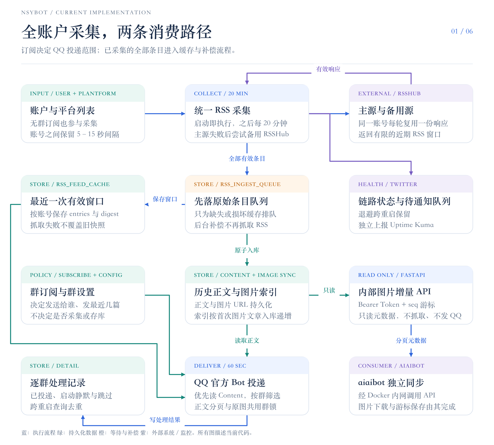
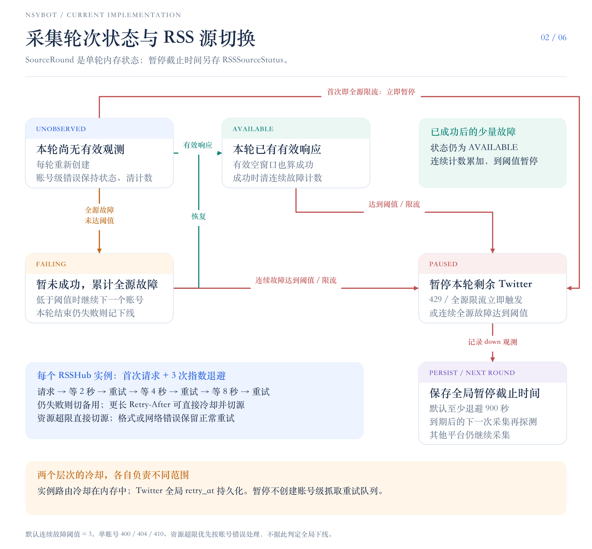
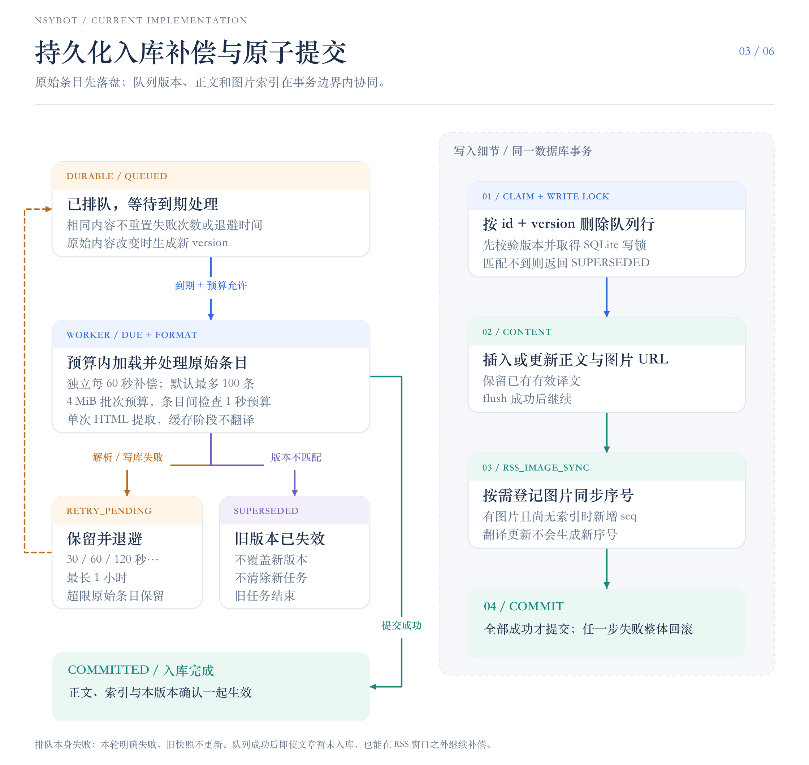
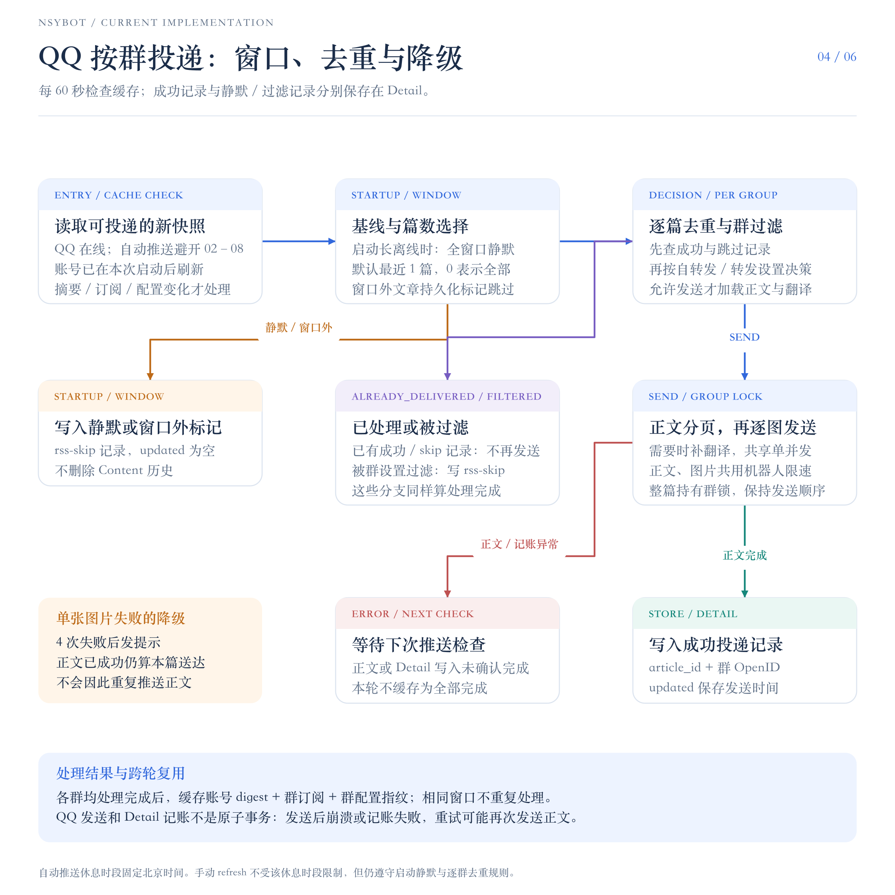
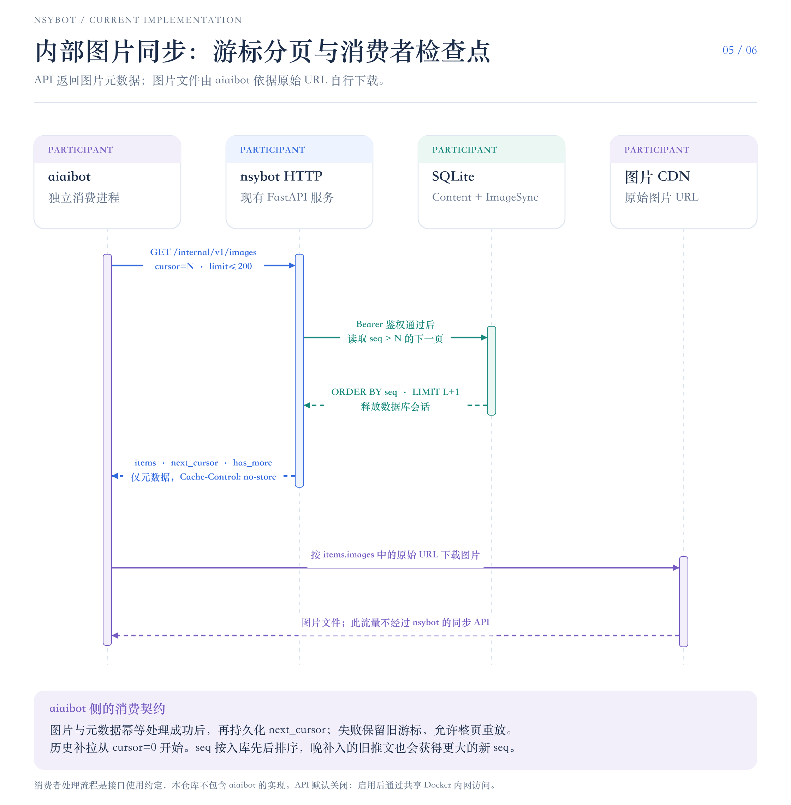
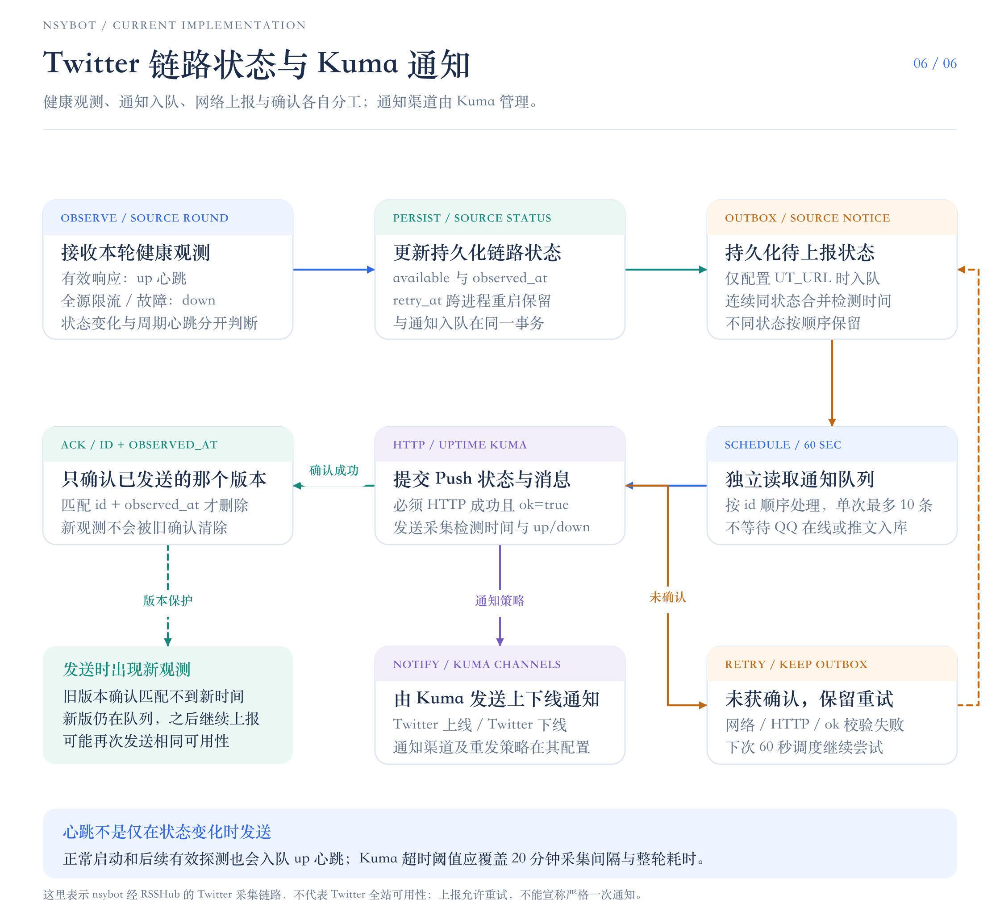

# nsybot 状态机与数据流转图

[返回项目首页](../README.md) · [RSS 使用指南](rss.md) · [图片同步 API](image-sync.md) · [性能与资源预算](performance.md)

本文对应 **2026-11-21 当前代码实现**，覆盖 RSS 采集、持久化入库补偿、QQ 投递、aiaibot 图片同步和 Twitter 链路监控。六张图统一使用宋体（当前导出采用宋体-简 / Songti SC），正文嵌入高清 PNG，点击图片可打开可放大的 SVG 矢量版；阅读不依赖 Mermaid 或绘图插件。

核心关系是：**账户列表决定抓取范围，群订阅决定投递范围，图片同步读取已经入库的图片文章。** 这三件事共用数据，但不共用一份“是否已发送”状态。

## 1. 整体数据流

[](assets/rss-architecture/01-overview.svg)

`User` 与 `Plantform` 提供账号及 RSS 路由；没有任何群订阅的账号也会采集。每次取得有效响应后，先检查已有 `Content`，把缺失或图片缓存损坏的原始条目持久化到补偿队列，再尝试预算内入库，并保存账号窗口快照。已有完整缓存的文章不会重复排队。

有效空 RSS 只证明链路恢复，保留已有窗口，不用空数据覆盖旧快照，也不会刷新窗口的采集时间。

QQ 读取最近一次有效窗口，结合群设置与 `Detail` 决定发送；图片同步 API 从 `Content` 和 `rss_image_sync` 读取历史图片文章，覆盖启动静默、群过滤、窗口外和未被群订阅的已入库内容。图片文章暂未入库时暂不可被 API 读到；补偿提交后，它才获得可同步的索引。

图 1 展示自动链路。手动 `refresh` 顺序复用采集与缓存推送入口；手动 `rss` 则用本次响应补齐队列和 `Content`，再直接回复选定文章，不更新账号窗口快照，也不写自动投递的 `Detail` 去重记录。

| 数据 | 表 / 对象 | 负责回答的问题 |
| --- | --- | --- |
| 采集范围 | `User`、`Plantform` | 要抓哪些账号、走什么路由？ |
| 投递策略 | `Subscribe`、`Group_config` | 发给哪个群、发几篇、是否翻译及转发？ |
| 原始待处理数据 | `rss_ingest_queue` | 哪些已接受条目还需要补写？ |
| 最近有效窗口 | `rss_feed_cache` | 这个账号本轮有哪些投递候选？ |
| 历史正文与图片元数据 | `Content` | 已入库的文章和图片 URL 是什么？ |
| 图片同步顺序 | `rss_image_sync` | 哪些图片文章在游标之后首次入库？ |
| 逐群处理记录 | `Detail` | 这个群是否已经发送、静默或跳过这篇？ |
| Twitter 健康状态 / 通知 | `rss_source_status`、`rss_source_notice` | 链路是否可用、何时重试、哪些观测还未获 Kuma 确认？ |

## 2. 采集轮次状态与 RSSHub 切换

[](assets/rss-architecture/02-collection-state.svg)

这张图的四个大写状态是 [`SourceRoundStatus`](../nsy/plugins/rssget/state_machines.py) 的真实枚举，**只描述当前这一轮采集**。每轮重新创建 `SourceRound`；若数据库中的 Twitter 全局 `retry_at` 尚未到期，则直接以 `PAUSED` 开始，本轮跳过 Twitter，其他平台继续执行。

| 输入结果 | 本轮状态变化 / 动作 |
| --- | --- |
| 有效 RSS，包括有效空窗口 | 进入 `AVAILABLE`，清零连续故障数；本轮首次进入该状态时产生健康观测 |
| 全源账号级错误，如 404、失效账号或资源超限 | 保持当前状态，清零连续故障数，继续其他账号 |
| 全源服务 / 网络故障，尚无成功且未达阈值 | 进入或保持 `FAILING`，增加连续故障数 |
| 本轮已有成功，随后少量全源服务 / 网络故障 | 仍为 `AVAILABLE`，但累计连续故障数；恢复成功会清零 |
| 全部源失败，并包含限流结果 | 立即进入 `PAUSED`，产生 down 观测 |
| 连续全源故障达到阈值，默认 3 个账号 | 进入 `PAUSED`，产生 down 观测 |
| 本轮结束仍为 `FAILING` | 即使未达 3 个账号，也产生 down 观测 |

源切换发生在单账号请求内部：一个实例默认首次请求后再重试三次，等待 2、4、8 秒，之后切备用实例。`Retry-After` 更长时优先遵守；超过 30 秒可直接冷却当前实例并切源，资源超限也直接切源。**主源失败、备用成功，仍属于有效采集。**

要区分两类冷却：实例及路由冷却保存在进程内 `_rss_backoffs`，Twitter 全局暂停截止时间持久化在 `rss_source_status.retry_at`。退避到期不主动发起高频探测，而是在下一次采集任务中检查。当前没有账号级持久化抓取重试列表。

代码入口：[`collect_articles`](../nsy/plugins/rssget/__init__.py)、[`fetch_feed / _fetch_user_feed`](../nsy/plugins/rssget/functions.py)、[`source_round_transition / finish_source_round`](../nsy/plugins/rssget/state_machines.py)。

## 3. 入库补偿与事务边界

[](assets/rss-architecture/03-ingest-transaction.svg)

左侧的“已排队、处理、完成”是工作阶段示意，队列表没有另加一个 `status` 字段。实际持久化的是 `entry`、`version`、`attempts`、`next_retry_at` 和错误类别；写入结果使用三个真实的 [`WriteOutcome`](../nsy/plugins/rssget/state_machines.py)：

| 结果 | 含义 | 队列处理 |
| --- | --- | --- |
| `COMMITTED` | 本版本文章和图片索引已成功提交 | 本版本队列删除与数据写入一起生效 |
| `SUPERSEDED` | 当前队列已不存在或版本不再匹配 | 结束旧任务，不写旧正文、不删除新版任务 |
| `RETRY_PENDING` | 数据库写入未完成 | 保留任务，持久化失败次数和下一次到期时间 |

图中的保留退避分支还包括正文解析失败：这时补偿工作器直接安排重试，不会调用写入函数；`RETRY_PENDING` 枚举本身由数据库写入入口返回。

原子事务的顺序很关键：**先按 `id + version` 删除队列行以确认版本并取得写锁，再写 `Content`、按需登记 `rss_image_sync`，最后提交。** 中途失败时，删除动作也会回滚，因此不会出现“队列清掉了但正文或图片索引没落库”的确认丢失。

正文解析发生在事务外；缓存阶段不翻译、不发 QQ。解析失败、超限或数据库写入失败后，按 30、60、120 秒递增退避，最多 1 小时，持续失败仍保留。相同原始数据再次出现不重置退避；数据真正变化时更新版本，旧处理器不能覆盖或清除新版本。

| 默认预算 | 行为 |
| --- | --- |
| 独立补偿每 60 秒、最多 100 条 | 不依赖 QQ、夜间休息或下一次 RSS 返回 |
| 单条 JSON 256 KiB、每批原始数据 4 MiB | 先读取小型元数据和字节数，再加载预算内正文 |
| 批次处理时间 1 秒 | 在条目之间检查；未开始的条目仍待处理，不强制打断事务 |
| 已入队超限数据 | 标记 `EntryTooLarge`，原始内容保留；核实预算后调整配置可继续补偿 |

如果数据库连原始队列都无法写入，这轮会明确失败，不更新账号快照，也不能声称已经接受数据。新响应落队列使用独立的短 `_stage_lock`，不会先等旧补偿任务处理完才持久化。

代码入口：[`cache_entries / write_content / retry_pending_entries`](../nsy/plugins/rssget/update_text.py)、[`IngestQueueManager`](../nsy/plugins/rssget/ingest_queue.py)。

## 4. QQ 投递决策与成功边界

[](assets/rss-architecture/04-qq-delivery.svg)

自动推送每 60 秒读取缓存，02:00–08:00 北京时间休息。QQ 离线时等待连接恢复，采集与入库补偿继续运行。重启后，账号必须先有本次进程启动之后的有效窗口，才参与推送，避免旧快照提前消耗启动静默状态。

启动首轮按群检查上次真实送达时间；无记录或距今超过 20 分钟的群，先静默登记当前完整窗口。`push_limit=1` 默认只选最近一篇，`0` 表示全部，窗口外文章记录为跳过。静默和窗口策略由 `initialize_subscription` 落实；逐篇发送阶段再判断已处理记录与转发开关。

| 决策 | 具体行为 |
| --- | --- |
| `STARTUP` | 需要启动静默的群，当前窗口写入 `rss-skip` 标记 |
| `WINDOW` | 篇数窗口之外的文章写入 `rss-skip` 标记 |
| `ALREADY_DELIVERED` | 已有成功或 skip 记录，直接跳过 |
| `FILTERED` | 群设置不允许当前转发 / 自转发，写 skip 记录 |
| `SEND` | 加载正文，需要时补翻译，分页发正文，再逐图发送 |

`STARTUP`、`WINDOW` 是策略名称，不是 `Detail` 的状态列。`Detail` 通过成功记录、订阅初始化标记和 `rss-skip` 前缀区分处理结果；成功记录含发送时间，静默或跳过记录的 `updated` 为空。

图片最多尝试四次。某张图片最终失败时尝试发送失败提示；只要正文已经完成发送，这篇仍可记录成功，避免因为附件问题重复推正文。正文页发送失败会留待下次检查；若正文实际发出后进程退出、或 `Detail` 写入未获确认，下次可能重复正文，**QQ API 调用与数据库记账不属于同一原子事务**。

账号的 digest、订阅群和群设置指纹只用于进程内复用。任一群处理未完成，则下次继续检查；跨重启去重仍以 `Detail` 为依据。

代码入口：[`push_cached_articles`](../nsy/plugins/rssget/__init__.py)、[`send_cached_rss / send_text`](../nsy/plugins/rssget/functions.py)、[`DetailManager`](../nsy/plugins/rssget/models_method.py)、[`qq_utils`](../nsy/qq_utils.py)。

## 5. aiaibot 的图片同步数据流

[](assets/rss-architecture/05-image-sync.svg)

图片 API 复用 NoneBot 的 FastAPI 服务，两个项目独立部署，通过共享 Docker 网络通信，当前 Compose 不向宿主机发布该端口。nsybot 只提供图片元数据，不代理图片文件，也不因同步请求额外抓 RSS 或发 QQ。

| API 步骤 | 行为 |
| --- | --- |
| 鉴权与参数校验 | API 默认关闭；启用后校验 Bearer Token；`limit` 默认 100，最多 200 |
| 查询 | `ImageSync.seq > cursor`，按 seq 升序，读取 `limit + 1` 行判断是否还有下一页 |
| 序列化 | 只查 seq、文章 ID、作者、时间、链接和图片字段，先释放数据库会话再组装响应 |
| 响应 | 返回 `items`、`next_cursor`、`has_more`，游标是十进制字符串 |
| 消费者确认 | aiaibot 幂等处理成功后保存游标；失败保留旧游标，允许重放这一页 |

最后一步是消费者的接口使用约定，**本仓库不包含 aiaibot 的实现**。nsybot 不维护消费者的已读状态，也不会收到图片下载的逐条确认。

游标表示图片文章首次登记入库的顺序，不是推文发布时间。因此，晚补入的旧推文也能获得更大的 seq，被后续增量读到。`cursor=0` 可以从最早已入库索引补拉；修改已索引文章的翻译等字段不会产生新序号，这个接口不是任意字段变更日志。

完整性边界仍是实际抓到并成功入库的内容。数据库不能恢复已经滑出上游 RSS 窗口、且从未抓到的历史推文。单篇内的重复图片 URL 会去重；跨文章相同 URL 或下载内容是否相同，需要消费者自行幂等处理。

代码入口：[`list_images / image_item`](../nsy/plugins/rssget/image_sync.py)、[`ImageSync`](../nsy/plugins/rssget/models.py)。请求和部署示例见 [内部图片同步 API](image-sync.md)。

## 6. Twitter 上下线与 Uptime Kuma

[](assets/rss-architecture/06-kuma-health.svg)

这里的持久化健康状态由 `available`、`observed_at`、`retry_at` 表示，与图 2 的单轮 `SourceRound` 不同。状态写入和通知入队在同一数据库事务中完成。未配置 `UT_URL` 时仍记录健康状态，但不产生待上报通知。

连续同状态的末尾待通知记录合并检测时间；状态发生变化则追加一条，从而保留先下线、后上线的顺序。正常启动和后续有效探测同样会生成 up 心跳，不能只在状态变化时上报，否则 Kuma 会因长期没有心跳判定超时。

独立的 60 秒任务按顺序读取通知。必须同时取得 HTTP 成功响应和 JSON `ok: true`，才按 `id + observed_at` 确认删除。发送期间若同状态记录被新观测更新，旧时间戳不能删除新版记录。网络请求重试或确认丢失可能导致重复上报；通知渠道、上下线通知和重发策略由 Kuma 控制。

Kuma 的心跳超时需要覆盖 20 分钟采集间隔、整轮采集耗时和上报调度延迟。这里监控的是 **nsybot → RSSHub → Twitter 的采集链路**，不能据此判断 Twitter 全站是否下线，也不能用在线心跳代替入库补偿队列的健康检查。

代码入口：[`SourceHealthManager`](../nsy/plugins/rssget/availability.py)、[`source_health_transition`](../nsy/plugins/rssget/state_machines.py)、[`auto_source_status_func`](../nsy/plugins/rssget/__init__.py)、[`report_status`](../nsy/plugins/rssget/functions.py)。

## 7. 调度、锁与资源边界

以上流程在一个 Python worker 中异步协作，没有新增常驻处理子进程。数据库保存需要跨重启延续的事实，内存对象负责这一轮的执行控制。

| 入口 / 调度 | 频率 | 控制范围 |
| --- | --- | --- |
| 全账户采集 | 启动立即执行，生产每 20 分钟 | `_collection_lock`；账号串行，保留请求间隔 |
| QQ 缓存推送 | 默认 60 秒 | `_refresh_lock`；北京时间夜间休息 |
| 持久化入库补偿 | 默认 60 秒 | `_ingest_lock`；新条目先用独立 `_stage_lock` 落盘 |
| Kuma 待通知上报 | 60 秒 | `_source_notice_lock`；不依赖 QQ、推送或入库补偿 |
| 手动 `refresh` | 按命令触发 | 顺序调用采集、缓存推送；不受自动夜间休息限制 |
| 手动 `rss` / 文章列表 | 按命令触发 | 共用单个完整请求时隙；`rss` 复用取得的响应补缓存后直接回复 |
| 图片同步 API | aiaibot 主动请求 | 只读当前数据库，分页查询，不参与以上定时锁 |

| 资源 / 顺序约束 | 当前默认值 |
| --- | --- |
| Gunicorn worker | 1，避免重复调度与状态分叉 |
| 整个生产容器 | 300,000,000 字节，禁止额外 swap |
| 同时读取的 RSS 响应 | 最多 2 个；单次解压后默认 4 MiB |
| RSS 结构 | 最多 500 条、20,000 个 XML 元素、64 层嵌套 |
| 单条原始 JSON | 默认 256 KiB，超过限制的已入队条目保留 |
| 翻译 | 同时 1 个请求；取得时隙后开始 60 秒超时 |
| QQ 正文 / 附件处理 | 消息处理最多 3 个任务，实际发送仍按机器人与群限速 |
| 图片准备至上传完成 | 全部现有入口共用 1 个时隙，单张最多 10 MiB |
| 单群文章顺序 | 整篇正文分页与图片持有同一群锁 |

完整配置、内存测试和验证边界见 [性能与资源预算](performance.md)。

## 图源与更新方法

六张图的可编辑 SVG 与高清 PNG 均位于 [`docs/assets/rss-architecture/`](assets/rss-architecture/)，统一视觉主题位于 [`figures/theme.json`](../figures/theme.json)。SVG 字体优先 Songti SC，回退到 SimSun / Noto Serif CJK SC；PNG 已固化宋体排版，跨设备查看不会替换字体。排版生成器只使用 Node.js 标准库，不改变应用的 Python 运行依赖。

```bash
# 重新生成 SVG
node docs/diagrams/build-rss-architecture.mjs

# 同时生成文档使用的 2 倍分辨率 PNG；需要安装 librsvg 的 rsvg-convert
node docs/diagrams/build-rss-architecture.mjs --png
```

图源为 [`build-rss-architecture.mjs`](diagrams/build-rss-architecture.mjs)。更新状态枚举、调度频率、事务边界或投递规则时，应同步更新图源与本说明。PNG 已随文档保存，读者不需要安装 Node.js、librsvg 或 Mermaid。

重新导出 PNG 的环境需要可用的宋体字体；本次使用 macOS 宋体-简（Songti SC），仓库不包含字体文件。

本次六张图已通过字体、配色、几何与图文语义核查；[图形校验记录](assets/rss-architecture/qa.json) 保存了各图哈希、检查标签数与最小字号，便于核对文档和图片是否仍为同一版本。
